# FastCursor 0.1.0 — Ultra-Lightweight Win32 Native Cursor & Pointer Engine for Java

[](https://github.com/andrestubbe/FastCursor/releases/tag/0.1.0)
[](https://opensource.org/licenses/MIT)
[](https://www.java.com)
[-lightgrey.svg)]()
[](https://jitpack.io/#andrestubbe/FastCursor)

---

**🎯 Ultra-fast native Win32 cursor and pointer shape management for Java 21+ via Foreign Function & Memory (FFM).**

**FastCursor** replaces bulky AWT abstractions and legacy JNI DLL wrappers with direct, sub-microsecond Win32 `user32.dll` system calls. It offers instant thread cursor mutation, permanent window-class (`HWND`) cursor binding on hover, handle inspection (`get()`), and cursor visibility controls with zero native compilation.

---

## Quick Start

```java
import fastcursor.FastCursor;
import fastcursor.CursorType;

public class QuickStart {
    public static void main(String[] args) {
        // 1. Immediately change active thread cursor to WAIT spinner
        FastCursor.set(CursorType.WAIT);

        // 2. Query native Win32 HCURSOR memory segment
        var hCursor = FastCursor.get();
        System.out.println("Active HCURSOR: " + hCursor);

        // 3. Restore default arrow
        FastCursor.set(CursorType.ARROW);
    }
}
```

---

## Table of Contents

- [Quick Start](#quick-start)
- [Why FastCursor?](#why-fastcursor)
- [Key Features](#key-features)
- [Real-World Use Cases](#real-world-use-cases)
- [Architecture & Design](#architecture--design)
- [Supported Cursor Types](#supported-cursor-types)
- [Code Examples](#code-examples)
  - [1. Thread-Scoped Cursor](#1-thread-scoped-cursor)
  - [2. Window-Bound Cursor (HWND)](#2-window-bound-cursor-hwnd)
  - [3. Querying Active Cursor Handle](#3-querying-active-cursor-handle)
  - [4. Cursor Visibility (Show / Hide)](#4-cursor-visibility-show--hide)
- [Performance Benchmarks](#performance-benchmarks)
- [Technical Demos & Benchmarks](#technical-demos--benchmarks)
- [Installation](#installation)
  - [Option 1: Maven (Recommended)](#option-1-maven-recommended)
  - [Option 2: Gradle (via JitPack)](#option-2-gradle-via-jitpack)
  - [Option 3: Direct Download (No Build Tool)](#option-3-direct-download-no-build-tool)
- [Documentation](#documentation)
- [Platform Support](#platform-support)
- [Related Projects](#related-projects)
- [License](#license)

---

## Why FastCursor?

Standard Java cursor handling via `java.awt.Cursor` or JavaFX is plagued by severe architectural limitations for high-performance apps, games, and system tools:

- **Missing System Cursor Shapes**: Standard Java only maps a tiny subset of legacy cursors. Essential Windows cursors like `IDC_APPSTARTING`, `IDC_HELP`, or `IDC_SIZEALL` are either inconsistent or completely missing.
- **No Window-Level Class Binding**: AWT requires continuous hover listening. If the JVM Event Dispatch Thread (EDT) suffers a latency spike, the cursor freezes or exhibits jitter.
- **Missing Direct Handle Access**: Standard APIs do not expose the underlying Win32 `HCURSOR` handle needed for integration with low-level graphic APIs or native window frames.
- **The DLL / JNI Overhead Dilemma**: Traditional native workarounds rely on heavyweight JNA wrappers or custom C++ DLLs that require cumbersome compilation, extraction, and platform-specific deployments.

**FastCursor** circumvents all these limitations through direct **Java 21+ Panama FFM (Foreign Function & Memory)** calls backed by **FastCore**:

| Feature | Standard Java (`java.awt.Cursor`) | Legacy JNI / JNA | FastCursor (FFM) |
|:---|:---|:---|:---|
| **Underlying Mechanism** | AWT Peer abstraction | External C/C++ DLLs | **Direct `user32.dll` System Calls** |
| **Native DLL Required** | No | Yes (must be compiled & extracted) | **No (Zero DLL / Zero JNI)** |
| **Direct HCURSOR Query** | ❌ Not exposed | ⚠️ Complex JNI bridge | **✅ Native `FastCursor.get()`** |
| **Window Class Binding** | ❌ Event-polling only | ⚠️ Complex JNI bridge | **✅ Native `SetClassLongPtrW` (HWND)** |
| **Invocation Latency** | ~2–5 ms (EDT dispatch) | ~50–100 µs (JNI boundary) | **< 1 µs (Direct MethodHandle)** |
| **Preloaded Handle Cache** | No | Manual implementation | **✅ Built-in Concurrent Cache** |

---

## Key Features

- ⚡ **Zero JNI / Zero External DLLs**: Pure Java 21+ Project Panama talking directly to Windows `user32.dll`. No C++ compiler needed.
- 🎯 **Thread & Window Scoped Cursors**: Instantly switch the active thread cursor or register class-level cursor shapes (`SetClassLongPtrW`) per `HWND` so Windows applies them natively on hover.
- 🔍 **Native Handle Inspection**: Retrieve the calling thread's active `HCURSOR` address directly via `FastCursor.get()`.
- 🗲 **Sub-Microsecond Latency**: Built-in concurrent handle caching avoids redundant `LoadCursorW` Win32 calls.
- 🛡️ **Fail-Safe Fallbacks**: Pure downcall handles with zero JVM crashes, memory leaks, or GC allocations.

---

## Real-World Use Cases

- ✂️ **Desktop Snipping & Region Select ([FastScreenCapture](https://github.com/andrestubbe/FastScreenCapture))**: Instant switch to high-precision crosshair (`IDC_CROSS`) with zero frame delay.
- 🎨 **Canvas, Diagramming & CAD ([FastGUI](https://github.com/andrestubbe/FastGUI))**: Native resize pointers (`IDC_SIZEWE`, `IDC_SIZENS`, `IDC_SIZENWSE`, `IDC_SIZEALL`) that feel 100% native and responsive even during heavy background rendering.
- 🪟 **Window Hover Feedback ([FastWindow](https://github.com/andrestubbe/FastWindow))**: Bind custom cursors per window handle (`setForWindow`) for effortless interaction cues.
- ⏳ **Background Task Indication**: Immediate system spinner (`IDC_WAIT` / `IDC_APPSTARTING`) triggered on the calling thread without EDT queue contention.

---

## Architecture & Design

```
┌─────────────────────────────────────────────────────────────┐
│                       Your Application                      │
│            (Editors, Snipping Tools, Canvas, UI)            │
└──────────────────────────────┬──────────────────────────────┘
                               │
                               ▼
┌─────────────────────────────────────────────────────────────┐
│                    fastcursor.FastCursor                    │
│           (Facade: set, setForWindow, get, show, hide)       │
└──────────────────────────────┬──────────────────────────────┘
                               │
                               ▼
┌─────────────────────────────────────────────────────────────┐
│                fastcursor.NativeUser32Cursor                │
│     (FFM Linker / MethodHandles to user32.dll + Cache)      │
└──────────────┬───────────────────────────────┬──────────────┘
               │                               │
       Direct Downcall                 Concurrent Cache
               │                         (HCURSOR handles)
               ▼                               ▼
┌─────────────────────────────────────────────────────────────┐
│                     Windows user32.dll                      │
│   • SetCursor              • LoadCursorW                    │
│   • SetClassLongPtrW       • GetCursor                      │
│   • ShowCursor                                              │
└─────────────────────────────────────────────────────────────┘
```

---

## Supported Cursor Types

`CursorType` provides full coverage of standard Win32 IDC resource cursor shapes:

| Shape | `CursorType` | Win32 Identifier | Description |
|:---:|:---|:---|:---|
|  | `ARROW` | `IDC_ARROW (32512)` | Standard arrow pointer |
|  | `IBEAM` | `IDC_IBEAM (32513)` | Text selection I-beam |
|  | `WAIT` | `IDC_WAIT (32514)` | Wait / hourglass / spinner |
|  | `CROSS` | `IDC_CROSS (32515)` | Crosshair for snipping and precision selection |
|  | `APP_STARTING` | `IDC_APPSTARTING (32516)` | Arrow with small spinning wait circle |
|  | `HAND` | `IDC_HAND (32649)` | Link / button pointer hand |
|  | `SIZE_ALL` | `IDC_SIZEALL (32646)` | Four-pointed movement cursor |
|  | `SIZE_WE` | `IDC_SIZEWE (32644)` | Double-pointed horizontal arrow |
|  | `SIZE_NS` | `IDC_SIZENS (32645)` | Double-pointed vertical arrow |
|  | `SIZE_NWSE` | `IDC_SIZENWSE (32642)` | Diagonal NW-SE resize arrow |
|  | `SIZE_NESW` | `IDC_SIZENESW (32643)` | Diagonal NE-SW resize arrow |
|  | `NO` | `IDC_NO (32648)` | Prohibited / slashed circle |
|  | `HELP` | `IDC_HELP (32651)` | Arrow with question mark |
|  | `UP_ARROW` | `IDC_UPARROW (32516)` | Upward arrow |

---

## Code Examples

### 1. Thread-Scoped Cursor

```java
import fastcursor.FastCursor;
import fastcursor.CursorType;

// Set wait cursor during background computation
FastCursor.set(CursorType.WAIT);

// Restore default arrow
FastCursor.set(CursorType.ARROW);
```

### 2. Window-Bound Cursor (HWND)

```java
import fastcursor.FastCursor;
import fastcursor.CursorType;

long hwnd = 0x12345678L; // Native Win32 window handle

// Set hand cursor whenever mouse hovers over this window
FastCursor.setForWindow(hwnd, CursorType.HAND);
```

### 3. Querying Active Cursor Handle

```java
import fastcursor.FastCursor;
import java.lang.foreign.MemorySegment;

// Get the native HCURSOR handle of the active thread
MemorySegment hCursor = FastCursor.get();
System.out.println("Native HCURSOR address: 0x" + Long.toHexString(hCursor.address()));
```

### 4. Cursor Visibility (Show / Hide)

```java
import fastcursor.FastCursor;

// Hide mouse pointer
FastCursor.hide();

// Restore visibility
FastCursor.show();
```

---

## Performance Benchmarks

FastCursor is rigorously benchmarked via **OpenJDK JMH** to guarantee zero JVM allocation and sub-microsecond Win32 dispatch latencies:

| Benchmark / Operation | Throughput (ops/ms) | Ops per Second | Latency |
|:---|:---:|:---:|:---:|
| **`benchmarkGetCursorHandle`** (Direct Win32 `GetCursor`) | **~2,704 ops/ms** | **> 2.70 Million** | **< 370 ns** |
| **`benchmarkSetCursorCached`** (IDC handle resolution + `SetCursor`) | **~1,642 ops/ms** | **> 1.64 Million** | **< 610 ns** |
| **`benchmarkSetCursorSwitch`** (Active shape alternation) | **~1,473 ops/ms** | **> 1.47 Million** | **< 680 ns** |

*Measured on Windows 11 (x64), JDK 21.0.12.1. Pure Java 21+ Project Panama FFM direct downcalls with 0 bytes GC heap allocation.*

---

## Technical Demos & Benchmarks

| Case | Java Example | Launcher | Description |
|---|---|---|---|
| **Interactive Terminal Demo** | [Demo.java](examples/Demo/src/main/java/fastcursor/Demo.java) | `run-demo.bat` | Cycles through all Win32 system cursor shapes every 3 seconds directly over the console window. |
| **JMH Microbenchmark Suite** | [Benchmark.java](examples/Benchmark/src/main/java/fastcursor/benchmark/Benchmark.java) | `run-benchmark.bat` | JMH microbenchmark suite measuring Win32 downcall throughput and handle cache performance. |

Run the demo instantly via terminal:
```cmd
run-demo.bat
```

---

## Installation

### Option 1: Maven (Recommended)

Add the JitPack repository and the dependency to your `pom.xml`:

```xml
<repositories>
    <repository>
        <id>jitpack.io</id>
        <url>https://jitpack.io</url>
    </repository>
</repositories>

<dependencies>
    <!-- FastCursor Engine -->
    <dependency>
        <groupId>com.github.andrestubbe</groupId>
        <artifactId>FastCursor</artifactId>
        <version>0.1.0</version>
    </dependency>
    <!-- Required Native Platform & FFM Infrastructure -->
    <dependency>
        <groupId>com.github.andrestubbe</groupId>
        <artifactId>FastCore</artifactId>
        <version>0.1.1</version>
    </dependency>
</dependencies>
```

### Option 2: Gradle (via JitPack)

```groovy
repositories {
    maven { url 'https://jitpack.io' }
}

dependencies {
    implementation 'com.github.andrestubbe:FastCursor:0.1.0'
    implementation 'com.github.andrestubbe:FastCore:0.1.1'
}
```

### Option 3: Direct Download (No Build Tool)

Download the latest compiled JARs directly to add them to your classpath:

1. 🎯 **[FastCursor-0.1.0.jar](https://github.com/andrestubbe/FastCursor/releases/download/0.1.0/FastCursor-0.1.0.jar)** (The Core Cursor Engine)
2. ⚙️ **[FastCore-0.1.1.jar](https://github.com/andrestubbe/FastCore/releases/download/0.1.1/FastCore-0.1.1.jar)** (The Native Platform & FFM Loader)

> [!IMPORTANT]
> When executing on Java 21+, add the JVM arguments `--enable-preview --enable-native-access=ALL-UNNAMED` to permit direct Foreign Function & Memory (FFM) system calls.

---

## Documentation

- **[CHANGELOG.md](docs/CHANGELOG.md)**: Detailed version notes and update history.
- **[REFERENCE.md](docs/REFERENCE.md)**: Complete API manual and method signatures.
- **[PHILOSOPHY.md](docs/PHILOSOPHY.md)**: The engineering rationale for zero-DLL FFM performance.
- **[ROADMAP.md](docs/ROADMAP.md)**: Future milestones and planned features (`.ani`/`.cur` custom cursors).
- **[COMPILE.md](docs/COMPILE.md)**: Build and preview flags guide.

---

## Platform Support

| Platform | Architecture | Status | Notes |
|:---|:---:|:---:|:---|
| **Windows 10 / 11** | `x64` | ✅ Fully Supported | Win32 `user32.dll` via Java 21+ Project Panama FFM |
| **Linux (X11 / Wayland)** | `x64` / `AArch64` | 🚧 Planned | X11 `XFixes` / Wayland Pointer Shape Protocol |
| **macOS (Sonoma+)** | `Apple Silicon` / `x64` | 🚧 Planned | Cocoa `NSCursor` / CoreGraphics Direct Pointer API |

---

## Related Projects

- **[FastCore](https://github.com/andrestubbe/FastCore)** — Unified native loader and Project Panama FFM platform runtime.
- **[FastMouse](https://github.com/andrestubbe/FastMouse)** — Ultra-low latency native RawInput mouse interception (1,000–8,000 Hz).
- **[FastPointer](https://github.com/andrestubbe/FastPointer)** — Zero-overhead native address arithmetic and memory pointer abstraction.
- **[FastScreenCapture](https://github.com/andrestubbe/FastScreenCapture)** — High-speed Desktop Duplication (DXGI) and GDI screen grabber.
- **[FastRobot](https://github.com/andrestubbe/FastRobot)** — Low-latency native input automation and simulation.

---

## License

This project is licensed under the [MIT License](LICENSE).
Part of the **FastJava Ecosystem**.
